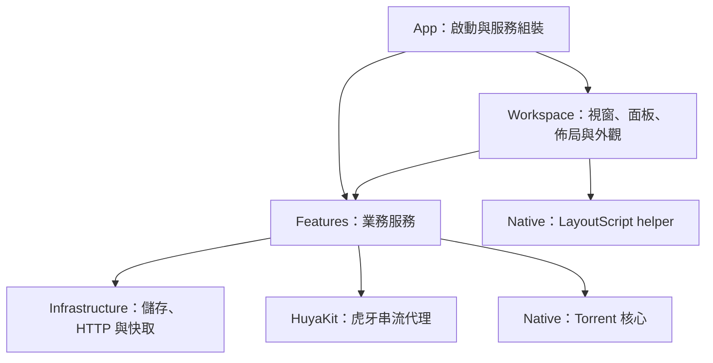

# IINA-ANI 架構

IINA-ANI 是以 Swift、AppKit、Core Data 與 WebKit 組成的 macOS 影音工作區，整合作品資訊、來源解析、播放、彈幕、收藏與下載。

## 工程與分層

主工程為 `IINA-ANI.xcodeproj`，target 與 scheme 為 `IINA-ANI`，Swift module 為 `IINA_ANI`。`App`、`Workspace`、`Features`、`Infrastructure` 與 `Shared` 是同一 module 內的功能分層；`HuyaKit` 為獨立 Swift Package，`Native` 提供原生核心與輔助程式。

`Shared` 提供各層共用的 extensions、日誌、識別常數、限流與計時工具。

## 目錄結構

| 路徑 | 職責 |
| --- | --- |
| `IINA-ANI/App/` | AppDelegate、AppServices、Preferences 與 MainMenu |
| `IINA-ANI/Workspace/Shell/` | 工作區入口、主視窗、頁面渲染、導覽、轉場與組件呈現狀態 |
| `IINA-ANI/Workspace/Panels/` | 搜尋、發現、詳情、收藏、下載、Torrent 與截圖識圖面板 |
| `IINA-ANI/Workspace/Settings/` | 偏好設定介面、設定搜尋與外掛設定 |
| `IINA-ANI/Workspace/Layout/` | 頁面與節點模型、組件登記、能力、驗證、編排、交易、保存與腳本執行 |
| `IINA-ANI/Workspace/Skin/` | 主題模型、封裝、驗證、保存、樣式解析與外觀控制 |
| `IINA-ANI/Features/Accounts/` | 站點帳號、OAuth、Cookies、Keychain 與登入介面 |
| `IINA-ANI/Features/Bangumi/` | Bangumi 模型、查詢與作品同步 |
| `IINA-ANI/Features/Discovery/` | 搜尋、推薦聚合、Bilibili 動態、YouTube 瀏覽與 trace.moe 識圖 |
| `IINA-ANI/Features/Sources/` | 來源登記、能力、配置、訂閱、選擇與統一媒體結果；`Decoders/` 存放解析器 |
| `IINA-ANI/Features/Playback/` | 播放協調、播放器參數、進度與歷史；`Danmaku/`、`JSPlayer/`、`OpenFiles/` 分別處理彈幕、網頁播放器及本機影片入口 |
| `IINA-ANI/Features/Downloads/` | 下載任務、來源解析、直連與 HLS 後端 |
| `IINA-ANI/Features/Torrent/` | 原生 session、RSS 搜尋、metadata、下載後端、HTTP Range 與串流播放 |
| `IINA-ANI/Infrastructure/Persistence/` | 作品、集數、來源映射、收藏、書籤、遷移與儲存路徑 |
| `IINA-ANI/Infrastructure/HTTP/` | 本機 HTTP、WebSocket 與虎牙路由 |
| `IINA-ANI/Infrastructure/Cache/` | 圖片快取 |
| `IINA-ANI/Shared/` | 跨功能共用工具 |
| `IINA-ANI/Core Data/` | 版本化資料模型 |
| `IINA-ANI/Assets/`、`Sources/`、`WebFiles/` | 圖像、來源 JSON 與網頁資源 |
| `HuyaKit/` | 虎牙串流套件與 `huyaproxy` CLI |
| `Native/` | Torrent C ABI、C++ 核心、建置腳本與 LayoutScript helper |
| `Config/` | Xcode 配置與本機配置範本 |
| `Tests/` | 按功能分類的回歸程式、fixtures 與 `run-*.sh` 執行入口 |
| `Examples/`、`Design/` | Skin／頁面動效範例與設計素材 |
| `docs/` | 使用指南、Skin 指南、架構文件與工作記錄 |

## 應用組裝與生命週期

`AppDelegate` 負責應用啟動、選單、工作區入口與關閉流程，持有 `AppServices` 和 `LibraryPersistence`；作品庫、收藏庫由後者統一組裝，書籤 DataManager 注入其共用 context 與收藏庫。

`AppServices` 是服務組裝根，注入 `Preferences`、`SourceRegistry`、`SiteAccounts` 與儲存路徑，組裝 `VideoDecoder`、`Processes`、`HttpServer` 和 `TorrentStreamingService`，按需建立 `DownloadService` 與 `PlaybackHistoryStore`。內建 JSPlayer 視窗也由此持有。

工作區 controller 持有目前頁面、選擇、分頁游標及查詢任務。已提交的下載與播放由應用層服務持有；面板移除時釋放其查詢和呈現狀態。AppKit 呈現與服務組裝主要位於 `MainActor`；`SiteAccounts`、`DownloadService` 及站點 actor 管理各自的非同步狀態。

## 工作區結構

### 主殼與產品面板

`WorkspaceApplicationController` 組裝工作區依賴與固定操作入口。主視窗協調側欄、頁面導覽與詳情轉場，`WorkspaceRenderer` 將 Layout 節點轉換為容器與產品面板。

主要面板分工如下：

- `WorkspaceServicePanelController`：發現、搜尋、站點瀏覽、下載與繼續觀看等服務介面。
- `WorkspaceDetailController`：作品與來源詳情、選集、評論、資訊子頁，以及來源／管理窗口。
- `WorkspaceFavoritePanelController`：作品收藏、連結收藏與更新資訊。
- `WorkspaceQuickDownloadController`：在線來源解析、批次選集與下載提交。
- `WorkspaceTorrentController`：Torrent 搜尋、匯入、metadata 與檔案選取。
- `ImageSearchWindowController`：本機圖片準備、辨識查詢與結果操作。

詳情主頁與資訊子頁各自持有捲動視圖，共用作品與查詢狀態。`WorkspaceDetailTransition` 處理封面轉場；`WorkspaceFeedGridLayout` 負責推薦網格的欄位與卡片座標。

### Layout、Skin 與呈現狀態

| 結構 | 內容 | 主要實作 |
| --- | --- | --- |
| Layout | 頁面、容器、組件實例、尺寸、斷點與頁面動效 | `WorkspaceModel`、`WorkspaceRegistry`、`WorkspaceValidation`、`WorkspaceTransactions`、`WorkspaceStore` |
| 編排草稿 | 編輯中的節點、操作紀錄與保存交易 | `WorkspaceLayoutEditor`、`WorkspaceLayoutEditorController` |
| Skin | 色彩、字型、密度、素材、組件狀態樣式與個人覆寫 | `SkinModel`、`SkinPackageValidator`、`SkinArchive`、`SkinStore`、`SkinAppearance` |
| 組件呈現狀態 | 各組件實例的查詢、篩選、分頁、選擇、捲動位置與密度 | `WorkspaceSessionState` |
| 應用偏好 | 語言、播放、彈幕、來源、下載與詳情顯示設定 | `Preferences` |

Layout 編排經驗證與交易保存。Skin 套件由封裝與儲存層管理，`SkinAppearance` 將主題及個人覆寫解析為 AppKit 樣式。LayoutScript 由獨立 helper 執行，結果送回 Layout 處理流程。

## 業務服務與資料流

### 搜尋與作品資訊

`BrowseSearchService` 整合 Bangumi 搜尋、來源搜尋與網址解析；`DiscoveryService` 聚合日常推薦及放送資訊。`BangumiService` 提供作品、集數、人物、關聯與評論資料，`BangumiWorkSync` 將作品資訊接入本機作品庫。

`SourceRegistry` 保存來源描述與能力，並提供完整 JSON 的預覽／原子匯入／同 ID 替換；使用者配置覆蓋隨包配置，匯入後停用，清單按 ID 排序。`SourceSubscriptionService` 另外處理搜尋規則訂閱，不冒充完整來源配置。`AnimeSourceService` 結合作品、集數與來源映射尋找候選；已保存的精確映射優先，失效時阻止自動換站。

M6 的兩端搜尋訂閱共用 `SourceSubscriptionRules` 的已審核 host／selector 規則。iOS `MobileSourceSubscription` 將 CSS1 搜尋更新做相容性核對、探測、差異預覽與原子 overlay 保存，不改完整配置的播放規則或來源啟用狀態。`MobileSourceDiscovery` 只在名稱、年份、類型、明確季度及唯一正篇集數證據完整時自動交接；候選不完整／歧義及既有失效映射都阻止自動播放。

Bilibili 動態及 YouTube 瀏覽使用各自的服務。`TraceMoeSearchService` 接收準備完成的圖片並返回辨識候選，結果由窗口送往作品搜尋、AniList 或預覽入口。

### 解析與播放

網址或作品選擇經 `VideoDecoder` 分派至站點解析器，產生 `YouGetJSON`／`Stream`；`PlayableSelection` 記錄來源、集數、線路與品質選擇。`PlaybackEncoder` 負責播放器參數編碼，`Processes` 協調解析後的媒體、彈幕及 IINA／mpv 啟播。

內建 JSPlayer 透過 WebKit 載入網頁播放器。播放進度回傳至 `PlaybackHistoryStore`；續看由 `AppServices.resumePlayback` 依保存的選擇重新取得媒體並定位播放時間。

M0 的純值契約由兩個 target 共用：`SourceSelection.swift` 的 `PlaybackWorkIdentity`／`PlaybackEpisodeIdentity`／`PlaybackContext` 保留領域與來源身份；`SourceConfiguration` 計算內容 fingerprint，並以宣告、解析器與平台能力的交集產生有效能力。`PlaybackContract.swift` 定義 session／load、分類錯誤與事件狀態；桌面 `PlayerProgressSession` 和 iOS `MPVEngine` 只把實際後端事實轉入共用狀態，解析 URL 或 seek UI 預測不建立觀看進度。M2 的 `ConfirmedSourceMapping` 保存完整上下文與確認時間，配置型頁面只保留宣告的身份 query，不保存媒體 URL 或帳號憑證。兩端都在成功解析後重新核對來源／配置／集數，先提交映射再交接播放；重用時刷新原目錄並重新解析原選擇，不以首集、其他線路或其他來源補缺。M3 在 iOS `SourcePicker → MobileSourceFlow → PlaybackSession` 的完整上下文上接入 `MobilePlaybackHistory`；續播重新解析原選擇，worker 在實際載入後 seek，經命令成功、seek／restart 事件與實際時間確認後才解除歷史寫入保護。桌面歷史沿用原主鍵，增加配置上下文及本地書籤；兩端以 recorder 所有權與刪除版本阻擋舊事件。

M4 的 `MobileSourceContinuation` 將原來源 client 與持久配置權威帶入 iOS 播放工作階段；手動／自然 EOF 下一集都重新取得同分組目錄及原線路／品質，不沿用舊媒體 URL，不自動寫入未確認的 Bangumi 集數映射。session／load／請求修訂及前景狀態共同限制一次性交接。桌面 `Processes` 依播放器 session 管理接續，`PlayerProgressSession` 保留 EOF socket，關閉／換片／重播可以撤銷尚未交接的結果；重播建立新 recorder lease，完季清理另驗證原 owner。iOS 字幕／彈幕附件按當次 `PlaybackEpisode.id` 保存，切集先清空再恢復目前附件，字幕僅在後端匯入成功後登記；檔案授權持有到核心銷毀。彈幕偏好獨立存於 UserDefaults，時間軸只使用實際媒體時間。

M6 的共用完整配置升至 v2 才可選 `danmaku`，宣告固定 `bilibili-xml` provider 與精確播放頁／aid／cid，參與配置 fingerprint；舊 v1 繼續接受原欄位，不接受新彈幕欄位。iOS `MobileBilibiliDanmakuProvider` 以訪客請求核對公開影片 metadata 與 XML chatid，拒絕 redirect、跨集、超限與不支援格式；`MobileAutomaticDanmaku` 以播放集數、load、請求版本及持久來源權威隔離結果。手動附件優先，關閉／取消／切集撤銷舊結果；桌面仍使用原生站點／播放器彈幕路徑，不把配置宣告誤當桌面新後端。

直播彈幕轉為 `DanmakuEvent`，經本機 WebSocket 傳往 IINA 彈幕外掛，或經 JavaScript bridge 送入 JSPlayer；點播彈幕使用 XML 檔案。虎牙串流由 `HuyaKit` 解析 `.slice`，經本機 FLV 代理提供給播放器。

### 帳號與請求上下文

`SiteAccounts` 管理帳號紀錄、預設帳號、驗證狀態及使用 lease。帳號 metadata 存於 UserDefaults，Cookies 與 OAuth 憑證存於 Keychain。

來源操作透過 `withSource`／`withAccount` 建立 `AccountHTTP.Context`，將來源身份、帳號與請求憑證傳入非同步操作。`BangumiOAuth` 處理 OAuth，`YouTubeBrowserCookies` 與 `YouTubeCookieImport` 處理瀏覽器及檔案的 Cookies 匯入。

iOS `MobileBangumiAccount` 使用官方 personal access token 與 `/v0/me` 驗證，不內嵌 OAuth client secret；`MobileBangumiKeychain` 以 device-only、解鎖時可用的項目保存權杖。分類寫入只送 `type`，沒有進度、評分、評論或 DELETE。每筆待同步變更持久保存數值 user ID 與本機修訂，無 owner 的離線變更需明確交給目前帳號；帳號 epoch／憑證版本／修訂阻止登出、切換、重入及延遲回應覆寫。遠端匯入先取完所有分頁，再以 Bangumi ID 去重合併；保留本機收藏與待同步修改。桌面 `WorkLibrary` 同樣保存 pending owner，`SiteAccounts` 阻止同一帳號紀錄重新授權成另一位使用者。

### 下載與 Torrent

`DownloadSourceResolver` 將來源選擇轉為下載輸入，`DownloadService` 持有任務紀錄、執行狀態、帳號 lease 與恢復流程。直連下載交由 `DirectDownloader`，HLS 交由 `HLSDownloader`，並透過 FFmpeg 封裝輸出。

Torrent 搜尋由 `TorrentSearchService` 讀取 RSS 配置。匯入與檔案選取取得 metadata 後，下載後端經 C ABI 呼叫 `Native` 中的 libtorrent 核心；同一 Torrent 的檔案任務共用底層傳輸。`TorrentStreamingService` 結合本機 HTTP Range 路由，將選定檔案提供給外部播放器。

## 資料模型與儲存

`LibraryPersistence` 封裝 Core Data container、載入錯誤、遷移前備份、書籤排序／收藏／作品分類遷移及退出前保存。儲存 URL 由 `AppStoragePaths.libraryStoreURL` 決定；測試可注入獨立 URL 與模型，初始化失敗不提供部分可用的資料庫，也不退回空白或暫存資料庫。

`WorkLibrary` 與 `FavoriteLibrary` 注入同一個 main-queue context，收藏庫重用同一個作品庫；收藏面板的變更通知僅監聽所屬 context。業務方法仍負責各自保存／回滾，這次未改為全域延遲提交。

`WorkLibrary` 管理 `Work`、`Episode`、`WorkSourceLink` 與 `EpisodeSourceMapping`：作品包含集數，來源連結指向站點作品，集數映射連接本機集數與可播放選擇。M2 在既有映射 payload 增加可選確認上下文與目錄分組，不更換 Core Data 主鍵；舊配置型映射須重新確認。`setPreferredMapping` 在同一次保存中替換該集的首選來源映射，保留其他集數與來源連結，失敗則回滾。`FavoriteLibrary` 管理作品收藏與連結收藏。

兩端共用 `Shared/CollectionStatus.swift` 的五種 `BangumiCollectionStatus` 與 `CollectionStatusFilter`；nil 是未分類，收藏資格獨立，讀取／加入收藏不推測分類。桌面仍用 Core Data，明確清除分類的本機修訂也受舊遠端回應保護，但不提交遠端刪除。

iOS `MobileLibrary` 以 `Application Support/ANI/library.json` v3 保存版本化收藏快照、穩定 `bangumi:<subjectID>` 作品分類、精確來源映射／失效狀態及帳號綁定的待同步修訂。舊 `favorites.json`、v1／v2 作品庫先各自備份，再經驗證暫存檔原子啟用；升級不推測遠端同步意圖。未知版本／壞檔禁止回退覆寫，保存前核對磁碟權威內容，成功後才發布可觀察狀態。映射獨立於收藏及資訊快取，移除收藏不刪映射，明確重新選源才移除該集映射。`CatalogCache/` 的基本資訊／集數快取有獨立時間戳與失敗狀態，不是收藏權威資料；`MobileCoverCache` 使用有容量上限的可清除圖片快取。M6 `MobileCatalogDetails` 按子頁延遲載入公開標籤、關聯與人物資料；短評沿用公開 Bangumi HTML 解析，分頁只接受同作品路徑，舊請求不能回填新子頁。補充資訊失敗不阻塞播放。

`playback-history.json` v1 獨立保存來源上下文或本地內容身份／書籤及實際秒數，原子提交後才發布，壞檔／未知版本禁止覆寫；移除收藏與重建快取均不刪歷史。`MobileLinkLibrary` 以獨立 `link-favorites.json` v1 保存標題與 `SourceItemRef` 公開頁身份，不寫入 Bangumi 作品庫、不解析成媒體；憑證、追蹤及簽名媒體網址不能當作連結身份保存。兩端不共享資料庫。

Core Data 模型位於 `Core Data/DataModel.xcdatamodeld`，目前模型為 `Library v0.5`，包含 `Bookmark`、`WorkRecord`、`EpisodeRecord`、`WorkSourceLinkRecord` 與 `WorkFavoriteRecord`；舊版本模型供遷移使用。

| 資料 | 儲存位置或機制 |
| --- | --- |
| 作品、集數、來源映射與收藏 | Core Data，位於 `Application Support/IINA+` |
| 偏好與帳號 metadata | UserDefaults |
| 帳號 Cookies、OAuth 憑證 | Keychain |
| 工作區佈局 | `Workspace/layout-v1.json` |
| 組件呈現狀態 | `Workspace/instance-state-v1.json` |
| Skin 套件與配置 | `Skins/` |
| 播放歷史 | `Playback/history-v1.json` |
| 下載任務 | `Downloads/tasks-v1.json` |
| 下載暫存與預設完成目錄 | `Downloads/Temporary/`、`Downloads/Completed/` |

上述 JSON、Skin 與下載路徑相對於應用的 Application Support 根目錄；`AppStoragePaths` 依 Bundle ID 建立該根目錄，目前為 `com.LlS.iina-ani`。

## 套件與資源組成

Swift 依賴由 Xcode 的 Swift Package Manager 整合，`HuyaKit/Package.swift` 定義虎牙 library 與 `huyaproxy` executable。`Native` 的 C++ 核心透過 `TorrentBridge.h` 與 Swift 交換 session、metadata、檔案及傳輸狀態。

`WebFiles/package.json` 管理網頁播放器與彈幕所需的 JavaScript 資源；`InstallDeps.sh` 準備這些資源與外部 IINA 彈幕外掛。圖像位於 `Assets/`，來源規則位於 `Sources/`，本地化字串由字串目錄及各網頁／Storyboard 資源提供。

`Config/App.xcconfig` 載入本機配置，將 Bangumi OAuth 應用設定注入 Info.plist。Xcode 建置階段同時整合 Torrent 原生核心與 LayoutScript helper。

Bundle ID 變更未包含自動資料遷移：舊 Bundle ID 目錄中的 Layout、Skin、播放歷史與下載任務不會自動轉入新目錄；UserDefaults 與帳號 Keychain service 亦隨 Bundle ID 改變。Core Data 仍使用上述 `Application Support/IINA+`，因此不能視為已與上游完整隔離。
