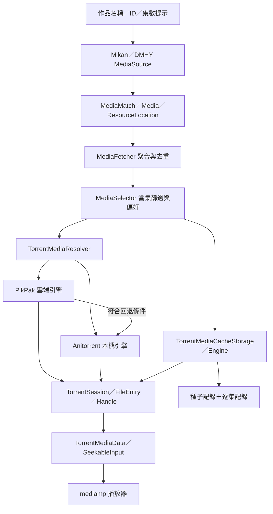

# Animeko Torrent 來源與下載播放模組審查

> 審查日期：2026-10-09。上游：[open-ani/animeko](https://github.com/open-ani/animeko)。
> 固定提交：[`3e3c22c91b2019504cb9f8e33e9749d37162b45c`](https://github.com/open-ani/animeko/commit/3e3c22c91b2019504cb9f8e33e9749d37162b45c)，提交時間 `2026-10-09T09:49:31Z`。
> 本文是獨立技術審查，不是 IINA-ANI 的 Torrent 接入成果或開工承諾。所有上游程式引用均固定到上述提交；不將浮動 main、註解或舊 review 當作執行證據。

## 1. 結論

Animeko 的「Torrent 源」是一條完整管線，而非單一磁力解析器：**來源發現、作品／集數配對、引擎選擇、可定位的媒體輸入、逐集持久快取與服務生命週期**各有責任邊界。

值得借鑑：

- 搜尋結果保留發布資源與集數範圍，先搜尋整部作品，再為當前集數選資源；合集不被誤建模成單集 URL。
- `TorrentDownloader → TorrentSession → TorrentFileEntry → TorrentFileHandle` 分層，讓播放與下載共享 session，分別持有檔案使用權。
- `TorrentInput` 只讀已完成 piece，將 seek／缺塊等待轉為下載優先級需求，不把「檔案已存在」當作「內容可讀」。
- 種子資料與逐集記錄分開持久化；同合集多集共享種子，選中檔案有自己的路徑／完成狀態。
- 本機 Anitorrent 與 PikPak 雲端實作共用上層契約，但播放回退、快取所有權與平台支援分別決策。

不宜照搬：**弱匹配選檔的靜默回退、piece 完成通知的訂閱競態、與實作不符的窗口／footer 註解，以及雲端失敗自動切換本機 P2P 的產品策略。** 詳見 §7。

## 2. 範圍與證據等級

| 等級 | 本次取得的證據 | 不代表什麼 |
| --- | --- | --- |
| 原始碼核對 | 來源適配器、查詢聚合、resolver、快取、Torrent API、本機引擎及部分 PikPak／Android 邊界 | 不代表網站在線、種子有 peers 或所有平台可播 |
| 隔離執行 | 原樣編譯上游 `api/pieces/` 四個 Kotlin 檔；執行窗口／prefetch／footer 與 piece 等待煙霧 | 不代表整個 Gradle 工程、JNI、真實網路下載或播放器驗收 |
| 既有測試閱讀 | 查閱來源、piece、快取與 resolver 的既有測試及檔案分布 | 本次沒有執行上游測試套件，不報告其通過 |
| 推論 | 以 `[INFERENCE]` 標明可能的消費者影響及整機風險 | 不把靜態可達分支寫成真實故障重現 |

未執行：Mikan／DMHY 網路健康檢查、真實 magnet／torrent 下載、PikPak 帳號授權、斷網續傳、做種、Android Binder 重連、iOS 或播放器視窗驗收。未修改上游或本專案生產程式。

## 3. 架構與責任



| 層 | 核心符號／目錄 | 責任與邊界 |
| --- | --- | --- |
| BT 來源 | `datasource/bt/mikan`、`datasource/bt/dmhy` | 從網站取得發布項目及 magnet／torrent，不下載媒體內容 |
| 資源契約 | `MediaFetchRequest`、`MediaMatch`、`Topic`、`ResourceLocation` | 區分查詢條件、匹配可信度、發布身份、集數範圍及下載方式 |
| 聚合／選擇 | `MediaFetcher`、`MediaSelector` | 並行來源查詢、狀態、去重；依當前集數與偏好選資源 |
| 解析／開啟 | `TorrentMediaResolver`、`TorrentMediaDataProvider` | 抓 metadata、選種子內檔案、取得 handle、維持服務使用權 |
| 引擎 | `torrent/api`、`torrent/anitorrent`、`torrent/pikpak` | 本機 P2P 或雲端實作，提供 session／檔案／統計 |
| 媒體輸入 | `TorrentMediaData`、`TorrentInput` | 可 seek 的讀取、piece 等待、下載統計、預取提示 |
| 持久快取 | `TorrentMediaCacheEngine`、`TorrentMediaCacheStorage` | 保存／恢復、單一引擎所有權、逐集檔案、暫停與刪除 |

來源：[媒體框架][framework]、[來源契約][topic-source]、[聚合器][fetcher]、[解析器][resolver]、[媒體輸入][media-data]。

## 4. Torrent 來源發現

### 4.1 實際內建來源

- Mikan 有 `mikan`（`mikanani.me`）與 `mikan-mikanime-tv`（`mikanime.tv`）兩個來源身份。
- App 預設 BT 清單為 **Mikan CN 與 DMHY**；不能從存在某個 factory 推定它已預設啟用。
- 此快照的 `datasource/bt/` 是 `mikan`、`dmhy` 兩個模組；不把一般 Web 源、Jellyfin 或 PikPak 算成第三個 BT 發布網站。

來源：[Mikan][mikan] L58–130、[預設來源][defaults] L74–82。

### 4.2 Mikan：作品索引優先，關鍵詞備援

1. 用 Bangumi subject ID 查本機 Mikan ID 對照。
2. 未命中時逐一使用作品名稱找候選索引；名稱取第一個空格前部分，最長 19 字。
3. 候選詳情頁最多並行 4 個，取 Bangumi ID 符合的索引，保存對照。
4. 讀取 `/RSS/Bangumi?bangumiId=…`，結果標為 `EXACT`。
5. 找不到索引或索引搜尋失敗，改用 `/RSS/Search`，中文作品名稱只取前 10 字，標為 `FUZZY`。

`fetch` 是單頁結果。App 注入持久 Mikan 索引快取；來源預設實作則可用記憶體快取。`EXACT` 代表作品索引匹配，不代表種子內集數已正確選中。

**重要邊界：**有效索引的 RSS 回傳空清單時，`list != null` 已成立，直接回空，不會再走 keyword。取消在 fetch 路徑明確重拋；非取消的索引錯誤才可備援。

來源：[Mikan][mikan] L156–270、[持久索引][mikan-cache] L23–44。

### 4.3 DMHY：多名稱查詢與自行遞增分頁

- `TopicMediaSource.fetch` 對作品的各個名稱建立動漫分類查詢，`allowAny=true`，合併各查詢；不提前裁掉其他集數。
- 分頁從 1 起；空白 keyword 不發請求，ASCII 冒號先換空格。
- 累積 raw 結果達 1000 停止；當頁映射後無結果亦停止。
- HTML 解析發布項目的 ID、標題、magnet、大小、發布時間及組別；共同標題解析器推導集數範圍、解析度、字幕等。
- `Network.list` 建立的是 **HTTP** URL。其 response 的 `currentPage/hasPreviousPage/hasNextPage` 固定為 `0/false/false`，實際翻頁由 `DmhyPagedSourceImpl` 自行管理，不能讀這三欄推定網站頁數。

來源：[DMHY 分頁][dmhy-paged] L26–99、[DMHY 請求][dmhy-network] L41–74、[來源契約][topic-source] L33–45。

### 4.4 身份、去重與匹配

`Topic.toOnlineMedia` 使用 `sourceId.topicId` 作 `mediaId`，保留原發布頁、下載位置、發布標題與集數範圍。Mikan 使用 RSS guid 的尾段；DMHY 使用發布連結尾段。

**不能說「沒有去重」：**`MediaFetcher` 在單來源累積與全域聚合分別以 `mediaId` 去重。另一方面，不同來源發布同一 infohash 時，其 source-prefixed ID 仍可能不同；這不是跨站 torrent 內容去重。

發布標題的集數解析是候選篩選工具，不是本機 Episode 的穩定身份。合集的 `episodeRange` 不應被展平成一個普通影片 URL。

來源：[來源契約][topic-source] L68–89、[聚合器][fetcher] L253–254、L469–470。

## 5. 從資源到可播放檔案

### 5.1 解析分成 resolve 與 open

- `supports` 同時檢查引擎平台能力與 `HttpTorrentFile/MagnetLink` 類型。
- `resolve` 取得 downloader、呼叫 `fetchTorrent`，回傳持有 encoded info 的 provider；此時不等同影片已載入。本機 Anitorrent 對 magnet 只編碼 URI，真正 metadata 等待在後續 session／`getFiles`；HTTP torrent 則先取得或讀取快取的種子 bytes。
- `open` 啟動／重用 session、等待檔案清單、選檔、建立 handle，以 `HIGH` priority 恢復下載，再產生 `TorrentMediaData`。
- provider 從 open 起維持服務使用權；失敗／取消清理 handle 並釋放權杖；正常 media close 用 cleanup scope 的 `NonCancellable` 工作關閉 handle 並在 finally 釋放。

來源：[解析器][resolver] L62–126、L274–402、[本機 downloader][downloader] L194–227。

### 5.2 選檔順序與精確性

`selectVideoFileEntry` 的順序為：

1. 依支援的副檔名取得影片候選，將 SP 等黑名單名稱排後。
2. 集名在路徑中唯一命中時選它。
3. 解析檔名的集數範圍，先比系列 `sort`，再比季度 `ep`。
4. 退至檔名包含集數字串。
5. 完整列表仍無匹配時，取第一個影片；不完整列表才回 `null`。

這是偏向「盡可能播放」的策略，不是嚴格匹配。黑名單只是排序，不是禁止；完整列表也可能選到其他集。已保存下載路徑的恢復邊界見 §7。

來源：[解析器][resolver] L160–230。

### 5.3 本機與 PikPak 不是同一種傳輸

本機 Anitorrent 使用原生 BT 引擎；PikPak 將 magnet 對應到雲端資源，再透過 CDN 讀取／快取，並非本機加入同一 swarm。兩者共用上層 Torrent API，不表示底層行為相同。

平台組裝將 PikPak 放在本機 resolver 前面，將第一個本機 resolver 設為顯式 fallback。不是一般 resolver chain「失敗就自然試下一個」。有 fallback 時，雲端 open 的 session 建立、列檔及 ready 檢查共享 **15 秒**預算；使用者取消及 `MediaSourceOpenException` 不走這條備援。沒有 fallback 時，這段 open 不套用同一超時預算。

**產品取捨：**雲端失敗切本機 BT 會改變 IP 暴露、上傳、磁碟與流量行為；IINA-ANI 若採用，應是明示策略，不應默認沿用。

來源：[resolver 組裝][resolver-list] L27–42、[解析器][resolver] L239–243、L338–381、[PikPak downloader][pikpak] L70–108。

### 5.4 Piece 調度與 SeekableInput

本機每個檔案建立 controller：頭部 2 MiB、尾部 0.5 MiB 作高優先級；窗口目標約 8 MiB，換算 piece 數後限制 2–64。header／footer pieces 交錯排列；預取位於當前普通 piece 清單之後。JNI adapter 以 piece deadline 表達優先順序。

`TorrentInput` 使用檔案隨機讀取與共享 piece 狀態：將檔案相對 offset 轉為 torrent 絕對 offset，缺塊時執行 `onWait` 並等待完成；前後預讀只合併相鄰已完成區塊，且限制於邏輯檔案範圍。每方向預設緩衝 64 KiB。

`TorrentMediaData` 將這個輸入交给 mediamp；提供 file stats、prefetch byte range，遠端串流可關閉 frame preview。它不是 HTTP URL，也不能直接拿 `torrent://dummy/...` 交給外部 IINA 播放。

注意：controller 註解的「只下載這些塊」不能單靠 Kotlin deadline adapter 推定為 native 的硬性排除；本次未審完外部 native artifact。窗口實際補位規則也與註解有差異，見 §7。

來源：[本機 session][session] L176–186、L253–289、L586–623、[輸入][input] L38–66、L131–163、[媒體輸入][media-data] L29–75。

## 6. 快取、恢復與生命週期

### 6.1 種子與逐集資料分離

| 記錄 | 身份 | 內容 |
| --- | --- | --- |
| `torrent_cache` | `mediaId` | encoded torrent data、相對儲存目錄；舊完成／檔案欄位僅供遷移 |
| `torrent_cache_episode` | `(mediaId, episodeId)` | 選定的 `pathInTorrent`、下載／上傳量、完成狀態 |
| 快取 metadata store | 資源與集數 | 下載意圖、autoCached 等上層狀態；變更需回寫持久 store |

同合集各集共享種子資料與 session，但各自有檔案記錄。刪除集數後，只有不存在其他 episode 記錄才刪種子資料列。檔案刪除仍要考慮共享 handle／session，不等同直接刪整個資料夾。

來源：[DAO][cache-dao] L27–69、L100–132、[快取引擎][cache-engine] L629–634、[快取 storage][cache-storage] L122–180。

### 6.2 避免同資源被兩個引擎重複快取

`selectTorrentStorage` 的優先順序：已持久保存的 owner → 本次實際播放引擎 → 引擎偏好。已存在 owner 但目前不支援時，不偷偷另建另一份。沒有 owner 時，PikPak 的 `canServe` 最多等待 10 秒，再考慮 Anitorrent。

這個決策同時供手動與自動快取使用；其身份仍以 Media ID 為基礎，不應解讀為任意來源間的 infohash 全域去重。

來源：[快取引擎選擇][storage-selection] L22–71。

### 6.3 播放可用、下載完成、做種完成不同

- `getCachedMedia` 在所選檔案完成且存在時回本機檔案；未完成則仍回 torrent 資源。
- UI cache state 的 `COMPLETED` 取決於檔案 bytes 已完成。
- DAO 的 episode `completed` 另外包含分享率門檻或無上傳活動的等待策略。因此不要把這些欄位當成同一個布林。
- 分享率計算使用 **session 上傳量／當前檔案下載量**，不是精確的單集上傳歸因；多集 session 的統計呈現需注意。
- App 啟動先還原 persisted caches，再清未使用目錄；服務重連與引擎可用性变化會刷新或補回缺失記錄。

來源：[快取引擎][cache-engine] L176–199、L272–279、L362–458、[storage][cache-storage] L68–118。

### 6.4 關閉與平台

本機 file handle close 移除自身使用記錄，session 沒有其他 open handles 才關閉；native 移除回呼完成 deferred，等待最多 7.5 秒。這是有界等待，不是 native 資源一定成功釋放的證明。

Android 有獨立服務、AIDL proxy 與遠端 file/session 介面；桌面走 JVM/native library。此快照的 Kotlin/Native Anitorrent factory 明確拋 `UnsupportedOperationException`；不能據此宣稱 iOS 本機 BT 可用。也不能沿用舊文檔的 `TorrentInput.native.kt TODO` 當作目前證據：現在輸入核心位於 `commonMain`，本機引擎支援是另一個問題。

建置設定提供 macOS x64／aarch64、Windows x64、Linux x64 桌面 native artifact；Windows ARM64 明示不帶本機 BT 引擎。這些是程式／建置能力宣告，不是本次各平台實測。

來源：[本機 session][session] L192–210、L538–581、[native factory][native-factory] L17–24、[建置設定][engine-build] L30–69。

## 7. Review 發現與風險

### P1：piece 完成發生於訂閱前，等待可能失去通知

**已確認程式路徑與隔離邊界：**`TorrentInput.fillBuffer` 先查 state，之後進入 `runBlocking` 執行 `onWait`／`awaitFinished`。`DefaultPieceList.awaitFinished` 只註冊未來通知，不在訂閱後重新確認當前 state；subscription 也不 replay 現況。

本次對上游原樣程式執行：piece 已設 `FINISHED`，呼叫 `awaitFinished`，200 ms 限時內仍不返回；訂閱後再送一次 `FINISHED` 通知則返回。

`[INFERENCE]` 若完成事件發生在外層檢查與訂閱之間，而且沒有第二次通知，讀取可持續等待到外部取消；本次未重現真實播放器掛死。

建議：將「檢查狀態＋訂閱」形成無漏接的契約，並確保完成與取消只能結束 continuation 一次。不能只加 timeout 掩蓋通知遺失。

來源：[輸入][input] L136–144、[PieceList][piece-list] L247–259、[訂閱][subscriptions] L49–67。

### P1：恢復時已存檔案路徑找不到，仍可改選其他檔

**靜態確認：**`getFileHandle` 先讀 `recordedPath`，但 `files.firstOrNull { path 相等 } ?: selectVideoFileEntry(...)` 會在已記錄路徑不存在時重新啟動啟發式配對。完整列表最終可退到第一個影片。

`[INFERENCE]` 雲端部分列表、資料損壞或檔案映射異常時，恢復可能選錯集，而不是報告已保存檔案不可用。普通同一 infohash 的本機 torrent 檔案列表通常固定，不能聲稱這是正常情況下必然發生的錯播。

建議：區分「從未選檔」與「已選檔但缺失」；後者應失敗或等待完整列表，重新選擇需要明確確認。

來源：[快取引擎][cache-engine] L661–687、[解析器][resolver] L222–230。

### P2：窗口註解與實際非首塊完成行為不一致

**已實測：**窗口 `[101,102,103]` 中的 102 完成，101 尚未完成，controller 仍補入 104，得到 `[101,103,104]`。實際是保留未完成首塊、补充後方未完成塊，不是註解描述的「非首部完成不擴展窗口」。

這不直接證明播放器會變慢，但後續設計與性能推導不能建立在舊註解上。應先決定要固定 piece 索引跨度，還是維持未完成請求數，再使程式與文檔一致。

來源：[controller][controller] L25–49、L198–254。

### P2：`possibleFooterSize` 沒有實作其宣告語義

此參數只保存於 constructor，沒有参与 seek 判斷。上游 session 傳入 8 MiB，但不能宣稱具有「片尾 probe 不重置窗口」能力。本次將其設為 1 與 15，使用相同近片尾 seek，優先級軌跡完全相同；靜態搜尋亦只見宣告／註解。

建議：刪除未實作契約，或基於真實 demux probe 行為補齊並驗證；不要將它作為已有優化引用。

來源：[controller][controller] L54–65、L171–180、[session][session] L176–185。

### P2：本機 fetch 的 timeout 參數未生效

**靜態確認：**Torrent API 的 `fetchTorrent(uri, timeoutSeconds=60)` 有 timeout 契約，但 Anitorrent 實作沒有使用此參數；HTTP cache miss 直接呼叫 HTTP downloader，magnet 僅編碼 URI。不能據此宣稱已對 metadata 取得提供 60 秒上限。HTTP client 可能另有 timeout，這也不等於遵守此呼叫參數。

建議：明確區分種子 bytes 取得、magnet metadata 等待與 open 的超時範圍；由實际執行階段承擔可取消的時間預算。

來源：[Torrent API][downloader-api] L61–77、[本機 downloader][downloader] L194–227。

### P2：DMHY 使用明文 HTTP 建立搜尋請求

**靜態確認：**搜尋 URL 使用 `URLProtocol.HTTP`。即使網站最終可能重定向 HTTPS，首跳仍沒有傳輸保護。

`[INFERENCE]` 發布清單、magnet 與搜索內容存在被網路中間人讀取／修改的風險；本次未驗證站點是否支援全程 HTTPS 或重定向行為。不能未查證便直接改域名或聲稱已被攻擊。

來源：[DMHY 請求][dmhy-network] L51–65。

### P2：resume 後 piece bitmap 同步仍需 native 端證據

Kotlin 初始化所有 piece 為 `READY`；`onPieceFinished` 再改 state。`onFileCompleted` 只設下載 bytes，刻意不將整個檔案所跨 piece 標完成，避免共享邊界誤判。`onTorrentChecked`／`onMetadataReceived` 路徑是條件式初始化，不是已建立 PieceList 的完整 bitmap 同步。

`[INFERENCE]` 若外部 native adapter 恢復時沒有補齊完成事件，檔案 bytes 與可讀 piece 狀態可能不一致。**本次未取得外部 native 實作／真實續傳證據，不能寫成已證實的永久等待 bug。** 審查應補一個部分下載、重啟、立即 seek 到已完成區域的 native 場景。

來源：[PieceList][piece-list] L133–149、[session][session] L355–404、L407–439、L453–485、L514–518。

### P3：Mikan 索引有值但 RSS 為空，不走關鍵詞備援

這是明確的程式行為，不一定是錯誤：它避免把其他同名作品混入，但索引陳舊時也可能漏掉候選。需要區分「正確作品真的沒有資源」與「快取對照已失效」，而非所有空結果都自動擴搜。

來源：[Mikan][mikan] L174–200、L218–231。

## 8. 本次執行證據

未改寫演算法；直接編譯這四份上游來源：

- `torrent/api/src/commonMain/kotlin/api/pieces/Piece.kt`
- `torrent/api/src/commonMain/kotlin/api/pieces/PieceList.kt`
- `torrent/api/src/commonMain/kotlin/api/pieces/PieceSubscribable.kt`
- `torrent/api/src/commonMain/kotlin/api/pieces/TorrentDownloadController.kt`

隔離工具鏈為 Kotlin CLI **2.2.21**、OpenJDK **25.0.1**、atomicfu-jvm **0.33.0**、immutable-jvm **0.4.0** 與編譯器隨附 coroutine jar。上游 catalog 宣告 Kotlin **2.4.10**；因此這是純 Kotlin 切片煙霧，不是鎖版 Gradle 建置成功。臨時 main 僅記錄優先級與驅動 piece 狀態，沒有替換生產 controller／PieceList 或啟動 P2P。

觀察輸出：

```text
resume=([100, 119], [101, 102, 103])
after_non_head_102=([100, 119], [101, 103, 104])
seek_near_footer=([100, 119], [118, 110])
OBSERVED: non-head completion admits a later piece while head remains unfinished
OBSERVED: prefetch filters duplicates/out-of-range/metadata; unchanged request emits nothing
OBSERVED: possibleFooterSize 1 vs 15 produces identical priorities for this scenario
OBSERVED: awaitFinished on FINISHED piece waits until timeout when no further state notification occurs
CONTROL: a subsequent FINISHED notification releases the waiter
```

窗口場景：20 個 1-byte pieces，絕對 index `100..119`，header／footer 各 1 byte，window=3；prefetch 輸入 `110,110,119,999`；比較 possibleFooterSize=1/15。這些微小尺寸是確定性演算法輸入，不是影片或吞吐量測試。

等待場景：先設完成，再以 200 ms timeout 呼叫 await；控制組在訂閱後補完成通知，以 1 秒限時確認返回。此場景證明缺少狀態重檢的必要邊界，不代替真實執行緒排程／JNI 競態復現。

## 9. 與既有 Animeko review 的差異

本節保留與較早、未固定 commit 的播放器審查之歷史比較；該審查原名為 `Animeko-review.md`，目前 repository 未收錄，故不提供本機連結。以下結論不得直接沿用：

- 現行 `TorrentInput` 位於 `commonMain`；iOS 本機 Anitorrent 不支援應引用 native factory，而不是舊檔案 TODO。
- 不採納「runBlocking 不響應外部中斷，因此必然卡死」這種籠統歸因。此處有傳入 coroutine context，`awaitFinished` 也有取消 hook；本次確實觀察到的是訂閱前完成無 replay。
- 窗口並非嚴格只由首塊完成推進；本次已執行反例。
- footer 參數未使用仍成立；resume bitmap 的後果仍需 native 證據。
- 現行還有 PikPak、顯式雲端 fallback、單一 cache owner 與逐集快取表，不能只用舊本機 BT 管線描述全貌。

## 10. IINA-ANI 可借鑑之處與接入邊界

以下是設計建議，不是已實作能力，也不改變既有 W2／M2 驗收或限定下載來源範圍。

| IINA-ANI 既有邊界 | 可借鑑設計 | 不應直接照搬 |
| --- | --- | --- |
| `SourceRegistry`／來源能力 | BT 發布網站仍作來源，明示搜尋、metadata、下載及串流能力 | 把 magnet 當現有 HTTPS 直連，或把 BT 引擎混成站點解析器 |
| `Work`／`Episode`／來源映射 | 區分發布資源、torrent 內容、所選檔案與本機 Episode；保存明確映射 | 只以檔名／陣列順序認定集數；恢復時缺檔便選第一個 |
| `DownloadService` | 保留單一任務 owner，由專用 torrent backend 管理 session／piece／handle | 在 View 中直接持有 native handle，或另造平行下載清單 |
| `PlayableSelection` | BT 身份至少需要 torrent 識別與所選檔案身份，不保存短效媒體地址 | 只保存 magnet 字串而忽略合集中的檔案選擇 |
| `Processes`／外部 IINA、mpv | 已完整下載檔可沿用既有開啟命令 | mediamp 的 SeekableInput 不能直接傳給外部播放器進程 |
| 快取與帳號生命週期 | 借鑑使用權、逐集刪除及帳號／服務所有權；區分可重建快取與下載資料 | 把 torrent 媒體當封面快取淘汰；偷偷換引擎／身份 |

**若日後決定接入，關鍵設計題是外部播放器的串流橋接，而非只寫 Mikan parser。** 本機未完成檔案的稀疏區不能直接當完整媒體播放；可評估受控 loopback Range 服務或正式播放器擴展，並驗證等待、取消、seek、關閉與多視窗。這是待決策方案，不是本次新增任務。

採納前至少需要：

1. 同 torrent 多集的精確身份、持久化與刪除隔離。
2. magnet metadata 逾時、無 peers、失效 tracker、目錄／磁碟錯誤可觀察。
3. 初播、跳頭／尾、來回 seek、取消等待及關窗釋放。
4. 部分下載程序重啟，已完成 piece 可讀，檔案缺失不換集。
5. 多 handle 共用 session，停止一個消費者不破壞另一個。
6. 本機 P2P 上傳／分享率／流量／隱私策略明示；雲端與本機切換需產品決策。
7. 新增 native binary 的架構、簽署、公證、最低系統與授權驗收。

### 授權與依賴

Animeko 根 LICENSE 與相關 Kotlin 檔頭為 **AGPLv3**；IINA-ANI 現有專案為 GPLv3。不能把「都是 GPL 家族」理解成可無條件複製再沿用原授權聲明。直接移植程式需評估組合作品的授權義務並保留聲明；只借鑑概念、獨立實作亦應保持來源與界限清楚。這不是法律意見。

此快照從 `org.openani.anitorrent:catalog:0.2.0` 取原生依賴，mediamp catalog 為 `0.5.1`；`vendor.version` 或 User-Agent 字串不等同實際 libtorrent binary 版本。外部 JNI／libtorrent／PikPak SDK 的完整授權、供應鏈與原生實作不在本次 Kotlin 快照審查結論內。

來源：[上游授權][license]、[依賴設定][settings] L39–42、L209–216、[版本 catalog][versions]、[引擎建置][engine-build]。

## 11. 固定版本原始碼索引

以下入口均指向同一 commit，可由檔案內行號定位上述證據：

- 搜尋：[Mikan][mikan]、[DMHY 分頁][dmhy-paged]、[聚合器][fetcher]。
- 播放：[resolver][resolver]、[媒體輸入][media-data]、[TorrentInput][input]。
- 引擎：[downloader][downloader]、[session][session]、[piece controller][controller]。
- 持久化：[cache engine][cache-engine]、[storage][cache-storage]、[DAO][cache-dao]。
- 平台與授權：[engine build][engine-build]、[native factory][native-factory]、[LICENSE][license]。

[framework]: https://github.com/open-ani/animeko/blob/3e3c22c91b2019504cb9f8e33e9749d37162b45c/docs/contributing/code/media-framework.md
[topic-source]: https://github.com/open-ani/animeko/blob/3e3c22c91b2019504cb9f8e33e9749d37162b45c/datasource/api/src/commonMain/kotlin/source/TopicMediaSource.kt
[mikan]: https://github.com/open-ani/animeko/blob/3e3c22c91b2019504cb9f8e33e9749d37162b45c/datasource/bt/mikan/src/commonMain/kotlin/MikanMediaSource.kt
[mikan-cache]: https://github.com/open-ani/animeko/blob/3e3c22c91b2019504cb9f8e33e9749d37162b45c/app/shared/app-data/src/commonMain/kotlin/data/repository/media/MikanIndexCacheRepository.kt
[defaults]: https://github.com/open-ani/animeko/blob/3e3c22c91b2019504cb9f8e33e9749d37162b45c/app/shared/app-data/src/commonMain/kotlin/data/repository/media/MediaSourceInstanceRepository.kt
[dmhy-paged]: https://github.com/open-ani/animeko/blob/3e3c22c91b2019504cb9f8e33e9749d37162b45c/datasource/bt/dmhy/src/jvmMain/kotlin/impl/DmhyPagedSourceImpl.kt
[dmhy-network]: https://github.com/open-ani/animeko/blob/3e3c22c91b2019504cb9f8e33e9749d37162b45c/datasource/bt/dmhy/src/jvmMain/kotlin/impl/protocol/Network.kt
[fetcher]: https://github.com/open-ani/animeko/blob/3e3c22c91b2019504cb9f8e33e9749d37162b45c/app/shared/app-data/src/commonMain/kotlin/domain/media/fetch/MediaFetcher.kt
[resolver]: https://github.com/open-ani/animeko/blob/3e3c22c91b2019504cb9f8e33e9749d37162b45c/app/shared/app-data/src/commonMain/kotlin/domain/media/resolver/TorrentMediaResolver.kt
[resolver-list]: https://github.com/open-ani/animeko/blob/3e3c22c91b2019504cb9f8e33e9749d37162b45c/app/shared/application/src/commonMain/kotlin/platform/TorrentMediaResolvers.kt
[media-data]: https://github.com/open-ani/animeko/blob/3e3c22c91b2019504cb9f8e33e9749d37162b45c/app/shared/app-data/src/commonMain/kotlin/domain/media/player/data/TorrentMediaData.kt
[input]: https://github.com/open-ani/animeko/blob/3e3c22c91b2019504cb9f8e33e9749d37162b45c/torrent/api/src/commonMain/kotlin/io/TorrentInput.kt
[controller]: https://github.com/open-ani/animeko/blob/3e3c22c91b2019504cb9f8e33e9749d37162b45c/torrent/api/src/commonMain/kotlin/api/pieces/TorrentDownloadController.kt
[piece-list]: https://github.com/open-ani/animeko/blob/3e3c22c91b2019504cb9f8e33e9749d37162b45c/torrent/api/src/commonMain/kotlin/api/pieces/PieceList.kt
[subscriptions]: https://github.com/open-ani/animeko/blob/3e3c22c91b2019504cb9f8e33e9749d37162b45c/torrent/api/src/commonMain/kotlin/api/pieces/PieceSubscribable.kt
[session]: https://github.com/open-ani/animeko/blob/3e3c22c91b2019504cb9f8e33e9749d37162b45c/torrent/anitorrent/src/commonMain/kotlin/session/AnitorrentDownloadSession.kt
[cache-engine]: https://github.com/open-ani/animeko/blob/3e3c22c91b2019504cb9f8e33e9749d37162b45c/app/shared/app-data/src/commonMain/kotlin/domain/media/cache/engine/TorrentMediaCacheEngine.kt
[cache-storage]: https://github.com/open-ani/animeko/blob/3e3c22c91b2019504cb9f8e33e9749d37162b45c/app/shared/app-data/src/commonMain/kotlin/domain/media/cache/storage/TorrentMediaCacheStorage.kt
[cache-dao]: https://github.com/open-ani/animeko/blob/3e3c22c91b2019504cb9f8e33e9749d37162b45c/app/shared/app-data/src/commonMain/kotlin/data/persistent/database/dao/TorrentCacheInfoDao.kt
[storage-selection]: https://github.com/open-ani/animeko/blob/3e3c22c91b2019504cb9f8e33e9749d37162b45c/app/shared/app-data/src/commonMain/kotlin/domain/media/download/TorrentStorageSelection.kt
[pikpak]: https://github.com/open-ani/animeko/blob/3e3c22c91b2019504cb9f8e33e9749d37162b45c/torrent/pikpak/src/commonMain/kotlin/me/him188/ani/torrent/pikpak/PikPakTorrentDownloader.kt
[native-factory]: https://github.com/open-ani/animeko/blob/3e3c22c91b2019504cb9f8e33e9749d37162b45c/torrent/anitorrent/src/nativeMain/kotlin/anitorrent/AnitorrentTorrentDownloader.native.kt
[engine-build]: https://github.com/open-ani/animeko/blob/3e3c22c91b2019504cb9f8e33e9749d37162b45c/torrent/anitorrent/build.gradle.kts
[settings]: https://github.com/open-ani/animeko/blob/3e3c22c91b2019504cb9f8e33e9749d37162b45c/settings.gradle.kts
[versions]: https://github.com/open-ani/animeko/blob/3e3c22c91b2019504cb9f8e33e9749d37162b45c/gradle/libs.versions.toml
[license]: https://github.com/open-ani/animeko/blob/3e3c22c91b2019504cb9f8e33e9749d37162b45c/LICENSE.txt
[downloader]: https://github.com/open-ani/animeko/blob/3e3c22c91b2019504cb9f8e33e9749d37162b45c/torrent/anitorrent/src/commonMain/kotlin/AnitorrentTorrentDownloader.kt
[downloader-api]: https://github.com/open-ani/animeko/blob/3e3c22c91b2019504cb9f8e33e9749d37162b45c/torrent/api/src/commonMain/kotlin/api/TorrentDownloader.kt
